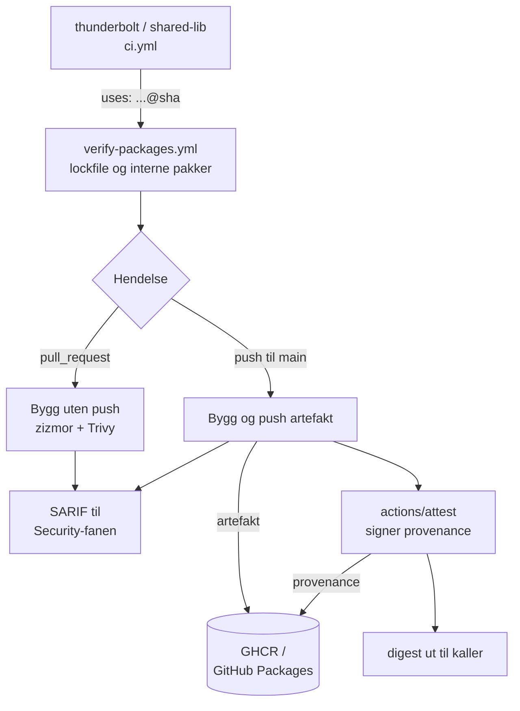

# workflows

Dette repoet inneholder de felles, gjenbrukbare GitHub Actions-workflowene som bygger, skanner, signerer og publiserer artefaktene i byggekjeden vi satte opp etter [SLSA v1.2](https://slsa.dev/spec/v1.2/). 

En utvikler som får merget noe i thunderbolt kan ikke endre hvordan imaget bygges eller hva provenancen sier. `main` her er beskyttet med branch protection, og kallerne pinner workflowen til en commit-SHA.

Prosjektet er avsluttet. Bakgrunn, flyt og trusselvurdering ligger i [thunderbolt](https://github.com/the-most-secure-supply-chain-ever-maaan/thunderbolt) og [sikkerhetsrapporten](https://github.com/the-most-secure-supply-chain-ever-maaan/thunderbolt/blob/main/SIKKERHETSRAPPORT.md).

## Repoer

| Repo | Innhold |
|---|---|
| [thunderbolt](https://github.com/the-most-secure-supply-chain-ever-maaan/thunderbolt) | Appens kildekode, Dockerfile og workflowen som starter bygget. Sikkerhetsrapporten ligger her |
| **workflows** (dette repoet) | De felles byggeworkflowene |
| [shared-lib](https://github.com/the-most-secure-supply-chain-ever-maaan/shared-lib) | Intern npm-pakke som bygges og attesteres av `build-package.yml` |
| [cluster-config](https://github.com/the-most-secure-supply-chain-ever-maaan/cluster-config) | Kubernetes-manifester og ArgoCD-oppsett |

## Workflows

| Workflow | Hva den gjør |
|---|---|
| `build.yaml` | Bygger container-imaget, pusher til GHCR og lager signert SLSA-provenance. Returnerer digesten |
| `build-package.yml` | Bygger npm-pakken, attesterer tarballen og publiserer til GitHub Packages. Returnerer digesten |
| `verify-packages.yml` | Sjekker `package-lock.json` og verifiserer attestasjonene til interne pakker. Kalles av de to over |
| `zizmor.yaml` | Statisk analyse av workflowene i dette repoet selv |

## Flyt



## `build.yaml`

Kalles fra appens egen `ci.yml`. Kjører i to varianter:

**Pull request** — bygger imaget lokalt uten å pushe, og kjører [Trivy](https://trivy.dev/) mot både imaget og filsystemet. `CRITICAL` og `HIGH` med kjent fiks feiler bygget. Funnene lastes opp som SARIF til Security-fanen.

**Push til `main`** — bygger for `linux/amd64` og `linux/arm64`, pusher til GHCR med `provenance: mode=max` og SBOM, skanner på nytt, og lager til slutt SLSA-provenance med `actions/attest`. Provenancen signeres med et kortlivet sertifikat fra Sigstore (Fulcio), logges i transparensloggen (Rekor) og pushes til registryet sammen med imaget.

```yaml
build-image:
  needs: build-and-test
  permissions:
    contents: read
    packages: write
    id-token: write
    attestations: write
    security-events: write
    artifact-metadata: write
  uses: the-most-secure-supply-chain-ever-maaan/workflows/.github/workflows/build.yaml@<commit-sha>
```

`id-token: write` er det som gjør at runneren kan hente et signeringssertifikat fra Fulcio. Uten den blir det ingen provenance.

## `build-package.yml`

Samme mønster for npm-pakker. På pull request kjøres `npm pack --dry-run`, og versjonen i `package.json` må være økt siden base. På `main` pakkes tarballen, lastes opp som artifact, og lastes ned igjen i et eget `publish`-steg som sjekker at sha256-digesten er uendret før den attesterer og publiserer. Dermed er det samme tarball som er signert og publisert.

## `verify-packages.yml`

Kjøres først i begge byggeworkflowene, og stopper bygget hvis avhengighetene ikke ser riktige ut:

- `lockfileVersion` må være 2 eller høyere.
- Alle avhengigheter må komme fra `registry.npmjs.org` eller `npm.pkg.github.com`, og ha `sha512`-integrity.
- Interne pakker under `@the-most-secure-supply-chain-ever-maaan` lastes ned, sjekkes mot integrity-hashen i lockfila, og verifiseres med `gh attestation verify`. Attestasjonen må komme fra `build-package.yml` i dette repoet, bygget fra `refs/heads/main`, på en GitHub-hostet runner.


## Konvensjoner

- **Alle actions pinnes til commit-SHA**, ikke tag. En tag kan flyttes; en SHA kan ikke.
- **`persist-credentials: false` på alle checkouts**, så `GITHUB_TOKEN` ikke blir liggende i `.git/config` der et vilkårlig byggesteg kan lese det.
- **`permissions: {}` på toppnivå** i `build.yaml`, og rettigheter gis per jobb.
- **`npm ci --ignore-scripts`**, så pakker ikke kan kjøre egne skript under installasjon.
- **Dependabot** oppdaterer actions daglig, med sju dagers karantene på nye versjoner.
- **Zizmor** kjører både på dette repoet og som steg inne i byggeworkflowene.

## Verifisere et artefakt

Krever [GitHub CLI](https://cli.github.com/), innlogget med tilgang til repoene.

Image:

```sh
gh attestation verify \
  oci://ghcr.io/the-most-secure-supply-chain-ever-maaan/thunderbolt@sha256:<digest> \
  --owner the-most-secure-supply-chain-ever-maaan \
  --signer-repo the-most-secure-supply-chain-ever-maaan/workflows
```

npm-pakke:

```sh
gh attestation verify <pakke>.tgz \
  --repo the-most-secure-supply-chain-ever-maaan/shared-lib \
  --signer-repo the-most-secure-supply-chain-ever-maaan/workflows
```

## Endre en workflow

Endringer her treffer alt som bygges. Rekkefølgen er:

1. PR mot `main`. Zizmor kjører på PR-en.
2. Merge.
3. Oppdater SHA-en i `uses:` i repoene som skal ta i bruk endringen.

Fordi kallerne pinner til SHA, får ingen endringen før noen oppdaterer den bevisst.

## Les mer

- [SLSA-spesifikasjonen v1.2](https://slsa.dev/spec/v1.2/)
- [GitHub: Using artifact attestations](https://docs.github.com/actions/security-for-github-actions/using-artifact-attestations)
- [GitHub: Security hardening for GitHub Actions](https://docs.github.com/actions/security-for-github-actions/security-guides/security-hardening-for-github-actions)
- [Zizmor](https://docs.zizmor.sh/)
